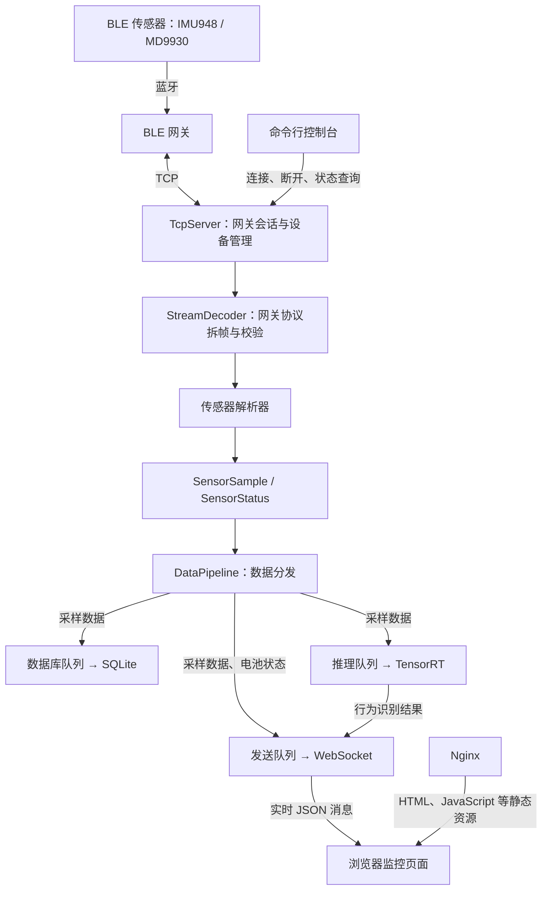

# 05 项目整体架构分析

整理日期：2026-09-05。本文依据当前源码整理；网页静态资源已由 Nginx 提供。

后续已实施设备订阅和图表刷新优化，详见 [06_WebSocket设备订阅与图表刷新优化](06_WebSocket设备订阅与图表刷新优化.md)。

## 一、项目定位

本项目是使用 C++17 编写的 BLE 物联网边缘计算服务。蓝牙传感器通过 BLE 网关上传数据，边缘服务通过 TCP 接收数据，完成协议解析、本地存储、行为识别和网页实时推送。

后端采用单进程、多线程架构，通过有界队列分离数据接收与下游处理。前端使用 HTML、JavaScript 和 Chart.js，由已配置的 Nginx 提供页面访问。

## 二、整体数据流



Nginx 负责提供网页静态资源，C++ WebSocket 服务负责实时数据。上图仅表达已知部署职责；是否通过 Nginx 反向代理 WebSocket，应以实际 Nginx 配置为准。

## 三、模块划分

以下源码路径均相对于项目根目录。

| 模块 | 核心职责 | 主要代码 |
|---|---|---|
| 程序入口 | 加载配置，创建和组装服务，处理 CLI、信号及退出流程 | `src/main.cpp` |
| 配置 | 管理监听地址、设备清单、传感器参数、队列容量和推理参数 | `include/iot/config.hpp`、`src/config.cpp`、`config/config.yaml` |
| 领域数据 | 统一表示传感器采样、设备状态和网关事件 | `include/iot/domain.hpp` |
| TCP 接入 | 接受网关连接，维护会话和设备状态，发送控制命令 | `src/services/tcp_server.cpp` |
| 网关协议 | 字节流拆帧、校验、异常数据恢复和控制命令编码 | `src/protocol/gateway_codec.cpp` |
| 传感器协议 | 分别解析 IMU948、MD9930 数据 | `src/protocol/sensor_parsers.cpp` |
| 数据分发 | 将统一的数据事件送入独立的下游队列 | `src/services/data_pipeline.cpp` |
| 数据存储 | 后台批量写入 SQLite，按天组织数据库文件 | `src/services/database_writer.cpp` |
| 异步推理 | 管理推理队列、工作线程和预测回调 | `src/services/inference_worker.cpp` |
| 推理逻辑 | 维护各设备的滑动窗口，整理模型输入，映射预测类别 | `src/services/inference_engine.cpp` |
| 模型后端 | 加载 TensorRT engine，管理 CUDA 资源并执行模型 | `src/inference/tensorrt_backend.cpp` |
| 实时推送 | 接受 WebSocket 连接，按设备订阅推送采样和预测，共享低频状态 | `src/services/websocket_server.cpp` |
| 网页展示 | 显示加速度波形、设备在线状态、电池信息及行为结果 | `web/index.html`、`web/app.js` |

### 统一数据模型

`SensorSample` 包含设备 MAC、设备类型、接收时间，以及可选的加速度、陀螺仪、磁场等字段；`SensorStatus` 表示电池、固件和产品信息等状态。

不同设备协议先转换为统一结构，下游存储和推理模块不需要直接解释传感器原始字节。

### 网关会话

`TcpServer` 为每个网关创建独立的 `Session`。会话线程负责接收 TCP 字节流、调用协议解析器、处理设备状态、发送排队命令，以及定期查询电量和尝试设备重连。

当前通过设备配置选择 IMU948 或 MD9930 解析器，并过滤未配置的设备。新增传感器类型时，除了实现解析器，还需要更新解析器选择逻辑和相关配置、命令处理。

## 四、线程模型与队列策略

```text
主线程：服务组装、CLI、生命周期管理
├── TCP accept 线程
│   ├── 网关 Session 线程 1
│   ├── 网关 Session 线程 2
│   └── 网关 Session 线程 N
├── SQLite 写入线程
├── 推理工作线程（推理后端可用时启动）
├── WebSocket accept 线程
│   └── 客户端处理线程
└── WebSocket 广播发送线程
```

`DataPipeline` 在接收路径中完成数据分发，不等待磁盘写入、GPU 推理或浏览器接收。各下游通过自己的队列和线程消费数据。

| 下游通道 | 当前配置容量 | 队列满时的行为 |
|---|---:|---|
| 数据库存储 | 30000 | 拒绝新样本，记录拒绝计数 |
| 模型推理 | 5000 | 丢弃最旧样本，保留较新的数据 |
| WebSocket 广播 | 4096 | 丢弃最旧消息，优先展示近期状态 |

这种设计限制了下游队列的内存增长，并隔离了处理速度差异，但不保证过载时数据零丢失。可通过 CLI 的 `stats` 查看队列长度、容量和丢弃情况。

## 五、存储与推理

### SQLite 存储

- 每天使用一个数据库文件：`data/YYYY_MM_DD/sensor.db`。
- 数据存入 `sensor_data` 表，包含时间、MAC、加速度、陀螺仪和磁场等字段。
- 使用 WAL、预编译语句及批量事务；每次从队列最多取出 100 条样本。
- SQLite 通过运行时动态加载使用，运行环境需要提供 SQLite 动态库。
- 当前保留期配置为 7 天；过期目录清理发生在 `DatabaseWriter` 构造时，依据目录修改时间判断。

当前采样数据进入数据库；电池状态和预测结果通过 WebSocket 推送，没有在这条存储路径中落库。

### 推理分层

```text
InferenceWorker：排队、线程与预测回调
        ↓
InferenceEngine：按 MAC 维护窗口、构造输入、映射类别
        ↓
InferenceBackend：模型执行接口
        ↓
TensorRtBackend：TensorRT / CUDA 实现
```

当前模型使用三轴加速度，窗口大小为 50、步长为 5，按通道排列输入。类别为 `standing`、`running`、`grazing`、`trotting`、`walking`。

运行时加载预先生成的 TensorRT `.engine` 文件；当前配置指向 `/home/aiam/opt/001demo/onnx/convtran.engine`。仓库中的 `model/convtran.onnx` 不会由这条运行路径自动转换为 engine。

后端未编译 TensorRT 或 engine 加载失败时，推理不可用，采集、存储和实时推送仍可运行。

## 六、Nginx 与网页部署

当前网页已经通过 Nginx 部署，无需另起临时静态文件服务。

浏览器的访问分为两部分：

1. 从 Nginx 获取 `web/` 中的页面和脚本。
2. 建立 WebSocket 连接，持续接收设备列表、传感器数据、电池状态和行为识别结果。

当前前端根据页面主机名构造 WebSocket 地址，默认端口为 `8765`，可通过页面 URL 参数 `wsPort` 覆盖；页面使用 HTTPS 时，前端选择 `wss`。具体 WebSocket 代理与 TLS 终止方式由实际部署配置决定，本文未检查 Nginx 配置。

后端默认监听 TCP `7628` 和 WebSocket `8765`。WebSocket 支持浏览器订阅当前设备的数据，设备连接与断开仍通过后端 CLI 的 `connect`、`disconnect` 命令控制。

## 七、构建与验证范围

`CMakeLists.txt` 定义三个主要目标：

| 目标 | 用途 |
|---|---|
| `iot_core` | 核心模块库，供主程序和测试复用 |
| `ble-iot-edge` | 后端可执行程序 |
| `protocol_tests` | 协议、配置、滑动窗口、有界队列和推理工作线程等测试 |

项目使用 C++17、标准线程和 POSIX 网络接口。TensorRT 默认启用，可通过 `-DIOT_ENABLE_TENSORRT=OFF` 构建不含 GPU 推理的版本。

本笔记基于源码静态阅读，未执行服务启动、硬件联调或 Nginx 配置验证。
