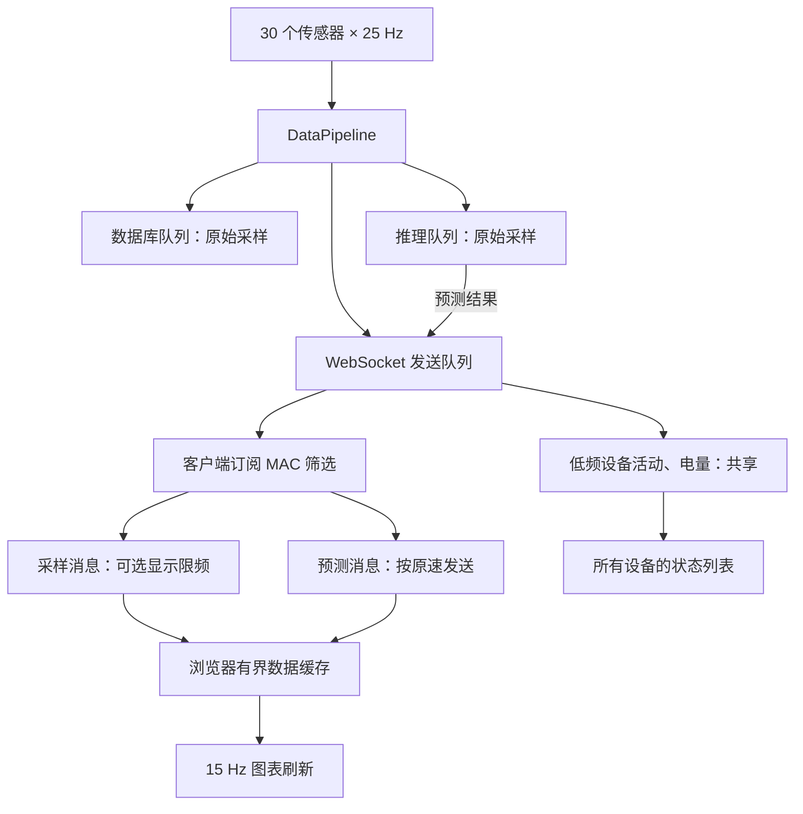

# 06 WebSocket 设备订阅与图表刷新优化

## 一、目标与方案

针对约 30 个传感器、每个 25 Hz 的场景，采集端约有 750 条采样消息/秒。浏览器通常只查看一个设备，没必要接收全部设备的波形，也没必要每收到一条数据就重新绘图。

本次实现采用三项改动：

1. 每个 WebSocket 客户端独立订阅一个设备，服务端按设备筛选采样和预测。
2. 前端收到数据时只更新有界缓存，图表统一按 15 Hz 刷新。
3. 默认保留选中设备的所有采样，也可选择 10 Hz 省流显示；显示抽点发生在 WebSocket 发送路径，不改变数据库和推理输入。

网页继续由已配置的 Nginx 提供。订阅命令通过现有 WebSocket 双向传递，切换设备不重新建立连接。

## 二、数据流



## 三、订阅协议

连接成功后，服务器首先发送设备列表。此时客户端只接收共享状态，直到发送订阅命令：

```json
{"type":"subscribe","mac":"AA:BB:CC:DD:EE:FF","sample_hz":0}
```

| 字段 | 含义 |
|---|---|
| `type` | 固定为 `subscribe` |
| `mac` | 单个设备 MAC，大小写均可；空字符串表示取消订阅 |
| `sample_hz` | 可选，默认 0；0 保留全部采样，1～25 表示显示推送频率 |

服务器返回：

```json
{"type":"subscribed","mac":"AA:BB:CC:DD:EE:FF","sample_hz":0}
```

订阅更新和该客户端的帧发送使用同一把锁，确认消息之后按新订阅筛选。前端在用户切换时立即清空旧图表，并按当前 MAC 过滤仍在途中的旧设备消息。

无效命令返回 `error`，不会改变当前订阅。命令限长 4096 字节；协议层处理掩码、TCP 拆包、文本分片、Ping/Pong 和 Close。

断线后前端按原有退避机制重连，收到设备列表时恢复当前设备及显示模式；如果原设备不在列表中，则选择列表首个设备。恢复连接时清空旧图表，避免把断线前后的行为片段直接连接起来。

## 四、设备在线状态

只推送选中设备的数据后，不能再根据是否收到其他设备的波形判断在线状态。因此增加共享的 `device_activity` 消息：

```json
{"type":"device_activity","mac":"AA:BB:CC:DD:EE:FF","age_ms":12}
```

每个有采样活动的设备最多每秒发送一次。`age_ms` 根据样本接收时间计算，前端换算为本地活跃时间；超过 5 秒没有活动则显示离线。此处“在线”表示近期收到采样，不等同于 BLE 连接状态。

电量继续作为低频共享消息；电量和预测消息不单独刷新采样活跃时间。

30 个设备持续工作时，每个浏览器的数据消息量大致为：

- 完整采样：25 条采样 + 约 5 条预测 + 最多约 30 条活动消息/秒。
- 10 Hz 显示：约 10 条采样 + 约 5 条预测 + 最多约 30 条活动消息/秒。

以上不含低频电量、订阅确认等消息，且不代表实测吞吐或字节带宽。

## 五、绘图与降采样

消息回调只更新数据并标记图表需要重绘；定时器每秒最多约 15 次调用 `chart.update('none')`。没有数据变化的图表不刷新，隐藏标签页暂停绘图。

默认完整采样模式不会因为绘图只有 15 Hz 而丢掉 25 Hz 的采样点。每轴最多保留 750 点，并按最近 30 秒裁剪；行为图保留最近 20 秒，同时设置点数上限。

10 Hz 模式在服务端按样本接收时间挑选展示点，每个客户端有独立限频状态。使用累计时间间隔处理 25 Hz 到 10 Hz 的非整数比率；设备切换和显示模式变更时重置限频状态。预测结果不参与抽点。

这是展示用抽点，可能漏掉短暂峰值，不是分析用的低通滤波或重采样。需要检查完整波形时选择完整采样模式，或查询原始数据库。

## 六、文件与验证

| 文件 | 改动 |
|---|---|
| `src/protocol/websocket.cpp` | 客户端帧解码和订阅命令校验 |
| `src/services/websocket_server.cpp` | 客户端订阅状态、发送路由、限频、活动消息及连接回收 |
| `src/services/data_pipeline.cpp` | 为采样消息附加 MAC 和接收时间，供推送层路由 |
| `src/main.cpp` | 为预测消息附加 MAC 路由信息 |
| `web/app.js` | 订阅、重连恢复、绘图合并、有界缓存和活动状态处理 |
| `web/index.html` | 完整采样 / 省流显示选择控件 |
| `tests/websocket_integration.py` | 真实 TCP/WebSocket、多客户端隔离、切换、限频、30 设备输入和落库验证 |
| `tests/web_frontend_tests.js` | 前端事件处理、刷新合并、缓存上限和重连恢复验证 |

Python 和 Node.js 测试由 CMake 在检测到相应解释器后注册到 CTest；集成测试使用临时数据库和本地动态端口，不依赖真实网关。

## 七、更新与边界

更新后端后需要刷新网页脚本，使浏览器发送订阅命令。旧网页连接新版后端时只会收到共享状态；后端和前端应配套更新。

继续使用现有 Nginx 静态资源部署方式；本文不假定具体反向代理路径，也不修改 Nginx 配置。

本次优化减少浏览器流量和绘图次数，但 WebSocket 全局发送队列仍接收全部采样，广播线程仍逐客户端发送。大量慢客户端对发送延迟的影响，以及真实 BLE 链路和 TensorRT 处理能力，仍需在目标设备上测量。
