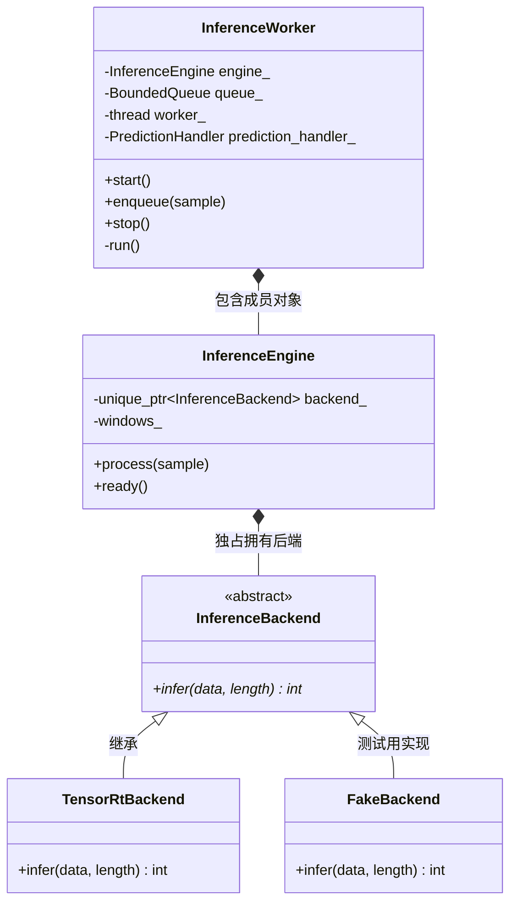

# 10 推理模块类关系与调用链

涉及的主要文件：

- [inference_worker.hpp](../../include/iot/services/inference_worker.hpp)
- [inference_engine.hpp](../../include/iot/services/inference_engine.hpp)
- [inference_worker.cpp](../../src/services/inference_worker.cpp)
- [inference_engine.cpp](../../src/services/inference_engine.cpp)

`InferenceWorker` 和 `InferenceEngine` 是组合关系；真正的继承关系发生在 `InferenceBackend` 与具体推理后端之间。

| 类 | 负责什么 |
|---|---|
| `InferenceWorker` | 管理队列和后台线程，接收采样、执行任务、回调结果 |
| `InferenceEngine` | 按设备积累滑动窗口、整理模型输入、将分类编号转换为动作名称 |
| `InferenceBackend` | 定义模型推理接口，由具体后端完成实际计算 |

## 1. 类之间的关系



在 `inference_worker.hpp` 中：

```cpp
class InferenceWorker {
    // ...
    InferenceEngine engine_;
};
```

表示“一个 Worker **拥有一个** Engine”。创建 Worker 时，它内部的 Engine 也会被构造。

继承的语法出现在 [tensorrt_backend.cpp](../../src/inference/tensorrt_backend.cpp)：

```cpp
class TensorRtBackend final : public services::InferenceBackend
```

这里的 `: public InferenceBackend` 表示继承；`final` 表示这个派生类不能再被继承。

`.hpp` 和 `.cpp` 不是两套类：头文件声明类的结构，源文件中的 `InferenceWorker::start()` 等定义属于同一个类。

## 2. 多态具体发生在哪里

`inference_engine.hpp` 定义了抽象接口：

```cpp
class InferenceBackend {
 public:
  virtual ~InferenceBackend() = default;
  virtual int infer(const float* channel_major_data,
                    std::size_t length) = 0;
};
```

- `= 0`：纯虚函数，`InferenceBackend` 本身不能直接实例化。
- 派生类通过 `infer(...) override` 实现实际推理。
- 虚析构函数保证通过基类指针释放对象时，派生类资源也能正确释放。

Engine 保存的是：

```cpp
std::unique_ptr<InferenceBackend> backend_;
```

**指针声明为基类类型，实际拥有的对象可以是 `TensorRtBackend`，也可以是测试中的 `FakeBackend`。**

因此，执行：

```cpp
backend_->infer(input.data(), input.size());
```

会根据实际对象调用对应的 `infer()`。这就是这里的运行时多态。

## 3. 对象如何创建

入口在 [main.cpp](../../src/main.cpp)：

```cpp
iot::services::InferenceWorker inference(
    config.inference,
    [&websocket](const std::string& mac, const std::string& action) {
      websocket.broadcast(iot::prediction_json(mac, action), mac);
    },
    config.queues.inference_capacity);
```

构造链如下：

```text
main 创建 InferenceWorker
  └─ Worker 构造函数：engine_(config)
       └─ InferenceEngine 构造函数
            └─ make_tensorrt_backend(...)
                 └─ 创建 TensorRtBackend
                      └─ 加载模型、创建执行上下文、申请 GPU 资源
```

默认构造路径中，只有编译启用了 TensorRT、配置启用了推理且后端加载成功，`backend_` 才存在。

Worker 的另一个构造函数接受：

```cpp
std::unique_ptr<InferenceBackend> backend
```

它允许调用方提供后端，再通过 `std::move` 将后端所有权转交给内部 Engine。例如测试注入 `FakeBackend`，就不需要加载真实 GPU 模型。

## 4. 数据的完整调用链

核心在 [data_pipeline.cpp](../../src/services/data_pipeline.cpp) 和 `inference_worker.cpp`：

```text
main
  └─ inference.start()
       └─ 创建后台线程，执行 InferenceWorker::run()

采样发布的调用线程
  └─ DataPipeline::publish(sample)
       └─ InferenceWorker::enqueue(sample)
            └─ queue_.try_push(sample)
                       │
                       │ 队列传递数据，切换到后台线程
                       ▼
推理后台线程：InferenceWorker::run()
  └─ queue_.wait_pop()
       └─ InferenceEngine::process(sample)
            ├─ 按 MAC 找到设备窗口
            ├─ 添加加速度采样，检查窗口和步长
            ├─ 整理 float 数组
            └─ backend_->infer(...)
                 └─ TensorRtBackend::infer(...)
                      └─ GPU 推理，返回分类编号
       └─ Engine 将编号转换为动作名称
       └─ prediction_handler_(mac, action)
            └─ 执行 main 注册的 lambda
                 └─ websocket.broadcast(...)
```

要区分两个动作：

- **`enqueue()` 只负责投递采样，不直接执行推理。**
- **`run()` 在后台线程里取采样，再调用 `process()`。**

```cpp
worker_ = std::thread(&InferenceWorker::run, this);
```

这句的含义是：创建线程，让它针对当前 Worker 对象执行 `run()`。

回调也在这个推理线程中执行。虽然 lambda 写在 `main()` 中，但它不会因此回到主线程执行。

`run()` 中的主要逻辑：

```cpp
while (auto sample = queue_.wait_pop()) {
  try {
    if (const auto action = engine_.process(*sample)) {
      if (prediction_handler_) prediction_handler_(sample->mac, *action);
    }
  } catch (const std::exception& error) {
    log(LogLevel::error, std::string("inference task failed: ") + error.what());
  }
}
```

队列为空时，`wait_pop()` 阻塞等待；有采样时取出处理。只有 `process()` 返回动作标签并且回调存在时，才调用回调。处理或回调中抛出的 `std::exception` 会被记录，随后循环继续。

## 5. process() 为什么不一定返回结果

接口为：

```cpp
std::optional<std::string> process(const SensorSample& sample);
```

返回值有两种情况：

```cpp
std::nullopt           // 这次没有预测结果
std::string("walking") // 这次产生了动作标签
```

具体处理过程是：

1. 没有后端，或者采样没有 `accel`，直接返回空。
2. 使用 `windows_[sample.mac]` 找到该设备自己的窗口，各设备分别积累数据。
3. 加入一条加速度，超过 `window_size` 就移除最旧一条。
4. 窗口未满，返回空。
5. 窗口满后累加步长计数，达到 `stride` 才推理，并重置计数。
6. 整理输入并调用后端，将有效分类编号映射为动作名称；无效编号会记录错误并返回空。

输入按通道排列：

```text
[x0, x1, ... xN-1, y0, y1, ... yN-1, z0, z1, ... zN-1]
```

数组长度是 `window_size × 3`，使用的是 `sample.accel`，不是陀螺仪或磁力计数据。

分类编号对应关系：

| 编号 | 动作标签 |
|---|---|
| 0 | standing |
| 1 | running |
| 2 | grazing |
| 3 | trotting |
| 4 | walking |

默认配置在 [config.hpp](../../include/iot/config.hpp) 中，`window_size = 50`、`stride = 5`。

**按照当前代码，首次推理发生在同一设备第 54 条有效加速度采样被处理时。** 第 50 条把窗口填满，同时计数变成 1；到第 54 条计数达到 5。之后每增加 5 条有效采样再推理一次。这里统计的是实际进入窗口的有效采样，未包含队列丢弃或缺少加速度的采样。

## 6. 队列和窗口是两种不同的缓存

| 缓存 | 位置 | 用途 |
|---|---|---|
| `queue_` | Worker 内 | 存放尚未处理的 `SensorSample`，所有设备共用 |
| `windows_` | Engine 内 | 按 MAC 保存最近的加速度序列，用于模型输入 |

队列满时，Worker 丢弃最旧的待处理采样，接收新采样。窗口满后又收到有效采样时，Engine 移除最旧加速度，使窗口持续向前滑动。

`enqueue()` 的返回值需要结合状态理解：

- 后端未就绪：直接忽略采样并返回 `true`，避免将禁用推理误报为队列拒绝。
- 后端就绪，但 Worker 未启动：返回 `false`。
- 新采样入队成功，包括丢旧换新：返回 `true`。
- 队列关闭等导致入队失败：返回 `false`。

因此，返回 `true` 不代表已经完成推理，也不保证会产生预测结果。

## 7. 停止与资源释放

调用 `stop()` 后，队列关闭并拒绝新数据；后台线程会处理完队列中已接收的数据，然后退出，`join()` 等待它结束。队列关闭并排空后，`wait_pop()` 返回 `std::nullopt`，使 `run()` 的循环结束。

Worker 析构时也会调用 `stop()`。内部 Engine 随成员析构而销毁，它拥有的 `unique_ptr<InferenceBackend>` 会释放实际后端对象；虚析构函数确保具体后端的清理逻辑得到执行。

阅读主线：**`main` 创建并连接对象 → Worker 排队和调度 → Engine 准备数据 → Backend 执行模型 → Worker 回调结果。**

## 8. print_pipeline_stats()：查看队列统计

[main.cpp](../../src/main.cpp) 中的 `print_pipeline_stats()` 读取数据库、推理和 WebSocket 三条处理路径的统计信息，让使用者观察是否积压、是否丢消息。

```cpp
void print_pipeline_stats(const iot::services::DataPipeline& pipeline,
                          const iot::services::DatabaseWriter& database,
                          const iot::services::InferenceWorker& inference,
                          const iot::services::WebSocketServer& websocket) {
  std::cout << "数据管道状态：\n"
            << "  数据库队列   " << database.queued() << '/' << database.capacity()
            << "，拒绝=" << pipeline.database_dropped() << '\n'
            << "  推理队列     " << inference.queued() << '/' << inference.capacity()
            << "，丢弃最旧=" << inference.dropped() << "，拒绝=" << pipeline.inference_rejected() << '\n'
            << "  WebSocket队列 " << websocket.queued_messages() << '/' << websocket.queue_capacity()
            << "，丢弃最旧=" << websocket.dropped_messages() << "，拒绝=" << pipeline.websocket_rejected()
            << '\n';
}
```

函数本身没有定义“正常”“异常”等状态，只是输出数字供人判断。在程序的交互命令中输入 `stats`，会调用它打印这些统计信息。

参数中的 `const ...&` 表示通过常量引用读取已有服务对象，不复制对象。例如：

```cpp
const iot::services::DatabaseWriter& database
```

输出表达式：

```cpp
database.queued() << '/' << database.capacity()
```

依次输出“当前排队数量”“斜杠”“最大容量”。**这里的 `'/'` 是字符，不是除法。** `<<` 用于向输出流写入内容，`'\n'` 表示换行。

### 8.1 输出中的数字是什么意思

示例输出，数字仅用于说明：

```text
数据管道状态：
  数据库队列   100/30000，拒绝=0
  推理队列     4800/5000，丢弃最旧=120，拒绝=0
  WebSocket队列 0/4096，丢弃最旧=5，拒绝=0
```

| 输出 | 含义 |
|---|---|
| `100/30000` | 当前有 100 条消息等待取出，队列最多容纳 30000 条 |
| `丢弃最旧=120` | 队列曾经满过，累计丢弃了 120 条旧消息来接收新消息 |
| `拒绝=0` | 管道向这个服务投递消息时，累计收到的失败返回值为 0 次 |

接口对应关系：

| 处理路径 | 当前排队数量 | 最大容量 | 累计丢弃最旧 | 管道累计投递失败 |
|---|---|---|---|---|
| 数据库 | `database.queued()` | `database.capacity()` | 不采用丢弃最旧策略 | `pipeline.database_dropped()` |
| 推理 | `inference.queued()` | `inference.capacity()` | `inference.dropped()` | `pipeline.inference_rejected()` |
| WebSocket | `websocket.queued_messages()` | `websocket.queue_capacity()` | `websocket.dropped_messages()` | `pipeline.websocket_rejected()` |

`database_dropped()` 虽然名字包含 `dropped`，在这里统计的是数据库投递被拒绝的次数，并非“丢弃最旧”的次数。

## 9. 消息队列有哪些状态

队列状态可以从“占用情况”和“是否接受新消息”两个维度理解。

### 9.1 占用情况

| 状态 | 判断方法 | 含义 |
|---|---|---|
| 空 | `queued == 0` | 当前没有排队等待取出的消息 |
| 非空且未满 | `0 < queued < capacity` | 有消息等待处理，还能容纳新消息 |
| 满 | `queued == capacity` | 容量已用尽，再来消息会触发溢出策略 |

### 9.2 是否接受新消息

| 状态 | 含义 |
|---|---|
| 开放 | 可以尝试入队，是否成功还取决于容量和策略 |
| 关闭 | 不再接收新消息，但内部可能还有尚未处理的消息 |

**“关闭”不等于“空”**，队列可能“已关闭但仍有积压”。

推理和 WebSocket 使用的 [BoundedQueue](../../include/iot/concurrency/bounded_queue.hpp) 有 `closed()` 查询接口，不过 `print_pipeline_stats()` 没有输出关闭状态，也没有输出服务线程是否运行。数据库使用自己实现的队列，通过 `stopping_` 控制停止。

## 10. 队列满时的策略与入队结果

三条处理路径采用的溢出策略不同：

| 队列 | 满时处理方式 | 统计表现 |
|---|---|---|
| 数据库 | 拒绝新消息，保留已排队的消息 | `拒绝` 增加 |
| 推理 | 丢掉最旧消息，接收新消息 | `丢弃最旧` 增加，本次入队算成功 |
| WebSocket | 丢掉最旧消息，接收新消息 | `丢弃最旧` 增加，本次入队算成功 |

假设队列容量为 3：

```text
当前队列：[A, B, C]
新消息：D

数据库：   [A, B, C]，拒绝 D
推理/WS： [B, C, D]，丢弃 A
```

`BoundedQueue` 定义了两种溢出策略：

```cpp
enum class OverflowPolicy {
  reject_newest, // 满时拒绝新消息
  drop_oldest,   // 满时丢弃最旧消息，接收新消息
};
```

一次入队操作有四种返回结果：

```cpp
enum class PushResult {
  pushed,         // 正常入队
  dropped_oldest, // 丢弃最旧消息后，新消息入队
  rejected,       // 队列满，拒绝新消息
  closed,         // 队列已关闭，无法入队
};
```

**这是“一次入队操作的结果”，不是队列的四种持续状态。** 数据库没有直接使用这个枚举，它自己的 `enqueue()` 以 `bool` 返回入队是否成功。

`拒绝` 不一定意味着队列满了，也可能是服务未启动、正在停止或队列已关闭。例如 WebSocket 服务未运行时，`broadcast()` 直接返回 `false`。

推理路径还有一个特殊处理：后端未就绪时，`enqueue()` 忽略采样并返回 `true`，所以不会因为推理禁用而增加拒绝计数。

## 11. 如何判断队列运行是否正常

最好连续观察几次，而不是只看一次：

| 观察结果 | 如何理解 |
|---|---|
| 排队数量较低，丢弃和拒绝不增长 | 通常说明消费速度能跟上输入 |
| 排队数量持续上升 | 消费暂时跟不上输入，正在积压 |
| 排队数量长期接近容量 | 队列压力较大 |
| 丢弃或拒绝计数持续增长 | 持续有消息没能保留在这条处理路径中 |
| 排队数量持续下降 | 消费正在消化积压 |

例如连续观察到：

```text
第一次：推理队列 1000/5000，丢弃最旧=0
第二次：推理队列 3000/5000，丢弃最旧=0
第三次：推理队列 5000/5000，丢弃最旧=200
```

说明采样进入的速度超过了推理消费的速度，最终开始丢弃旧采样。

解释统计时，还要注意以下边界：

- **丢弃和拒绝是累计值。** 当前队列为空，但丢弃数大于 0，可能只是以前发生过拥塞；判断当前是否还在丢消息，要看计数是否继续增长。
- **队列为空不代表工作全部完成。** 消息可能已经被取出，仍在执行数据库写入、推理或发送；也可能根本没有新数据输入。
- **入队成功不代表业务处理成功。** 数据库消息入队不代表已经写入成功，推理采样入队不代表一定产生预测结果，WebSocket 消息出队也不代表浏览器已经收到。
- **管道拒绝计数有统计范围。** `pipeline.websocket_rejected()` 只统计管道里的投递失败，不涵盖所有其他调用者，例如推理结果回调中的广播调用。
- **各项统计不是同一瞬间的完整快照。** 它们是依次读取的，其他线程同时在工作，所以打印期间数字仍可能变化。
